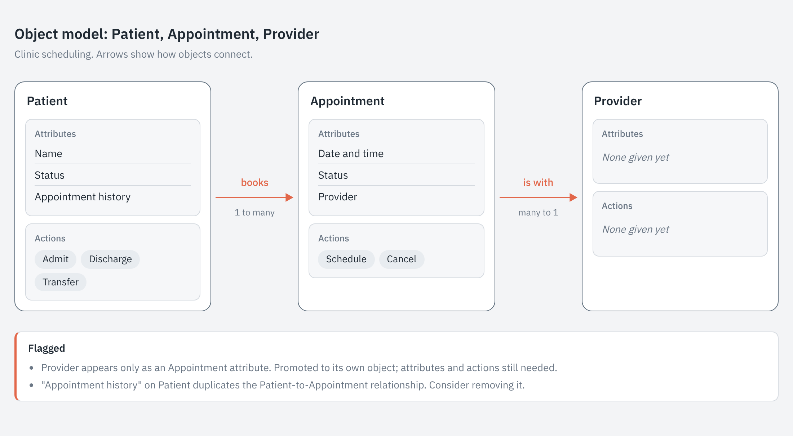

# AI skills

Custom skills for Claude. Each folder in this repo is one skill: a `SKILL.md` with the instructions Claude follows, plus any files those instructions use.

## Skills

| Skill | What it does |
| --- | --- |
| [ooux-object-model](ooux-object-model/) | Turns a rough list of objects, attributes, and actions into a consistent Object-Oriented UX (OOUX) object model and card-style diagram. |

### Example: ooux-object-model

## Install a skill

1. Download this repo as a ZIP.
2. Upload the skill's folder (for example `ooux-object-model`) to Claude as a custom skill. See support.claude.com for the current steps.

Each skill's own README has usage details.
