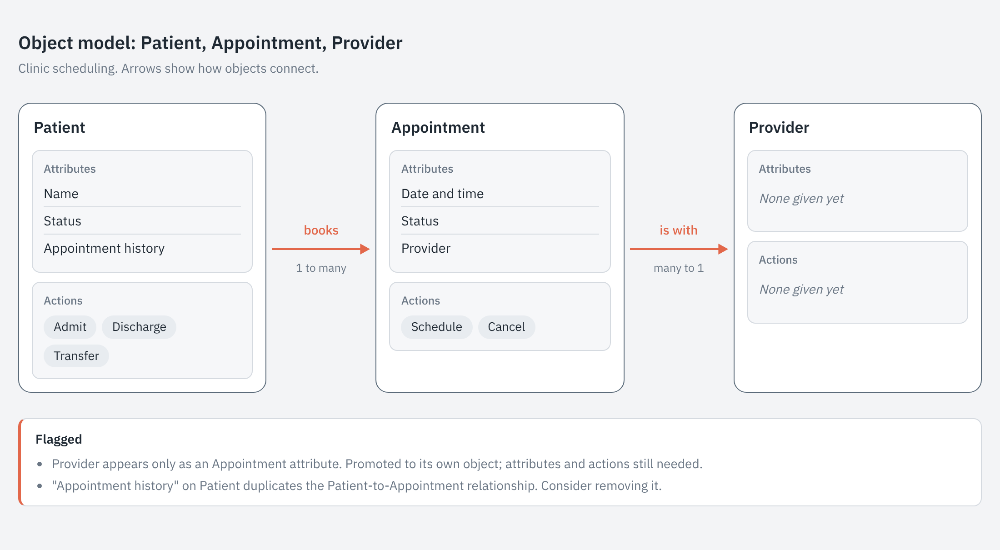

# OOUX Object Model skill

A Claude skill that turns a rough list of objects, attributes, and actions into a consistent object model. It's built on [Sophia Prater's Object-Oriented UX (OOUX) method](https://ooux.com).



## What it does

- Flags naming problems, vague actions, orphan objects, and duplicates
- Asks about unclear relationships instead of guessing
- Writes a markdown object model the whole team can read
- Builds a card-style diagram page, with optional Mermaid or FigJam export
- Keeps the model current as new objects come up, with a dated change log

## Install

Download this repo as a ZIP and upload the `ooux-object-model` folder to Claude as a custom skill. See support.claude.com for the current steps.

## Use

Paste a list like this and ask Claude to turn it into an object model:

```
Patient: name, status, appointment history. Can be admitted, discharged, transferred.
Appointment: date/time, status, provider. Can be scheduled, cancelled.
```

## Files

- `SKILL.md`: the skill instructions
- `assets/card-page-template.html`: the card diagram layout the skill fills in for each model
- `assets/images/example-diagram.png`: a screenshot of the template's example model, used in this README
