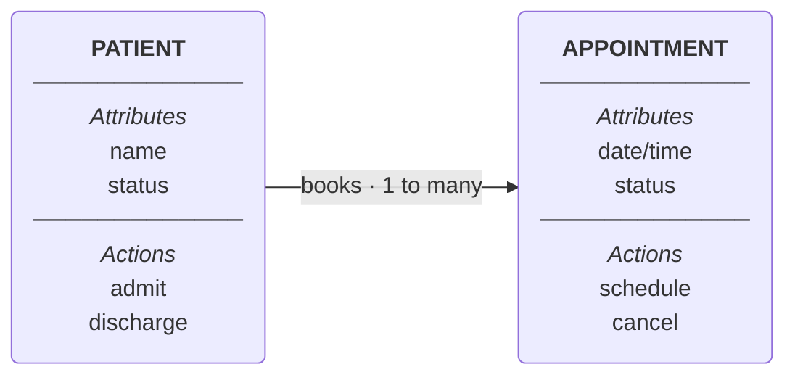

# OOUX Object Model Builder

Converts a rough object/attribute/action list into a consistent object model.
The model is the shared structure designers, engineers, PMs, and AI tools
build from, so consistency and clarity matter more than speed.

Deliverables, in order:
1. Flagged inconsistencies, with suggested fixes
2. A markdown object model (the source of truth)
3. A card-style diagram page (the default visual)
4. Optional exports: Mermaid flowchart, FigJam board

## Step 1: Parse the input

For each object, extract:
- **Name**: what the thing is called
- **Attributes**: the data it carries
- **Actions**: what it can do, or what can be done to it
- **Relationships**: how it connects to other objects

The input may be a clean list, loose notes, or a text file. Extract what is
there before adding anything.

## Step 2: Flag inconsistencies

Check for and flag, without silently fixing:
- **Naming inconsistency**: mixed singular and plural, mixed casing, or one
  real-world thing under two names
- **Vague actions**: verbs too broad to build from ("manage," "handle,"
  "process"). Suggest specific replacements based on context
- **Orphan objects**: no stated relationship to anything else
- **Missing attributes or actions**: an object with an empty section
- **Duplicate or overlapping objects**: two objects modeling the same thing

List each issue with a suggested fix.

## Step 3: Resolve ambiguous relationships

If a relationship is implied but not stated, do not guess. Batch these into
2 or 3 clarifying questions and ask before building the final model. Example:
"Does an Appointment belong to one Patient, or can several Patients share one
Appointment?" Include cardinality (one, many) in the question.

Only continue once relationships are confirmed.

## Step 4: Write the markdown model

Keep this format strict so every model reads the same way.

```markdown
# [Model title]

## [Object name]

**Attributes**
- Attribute one
- Attribute two

**Actions**
- Action one
- Action two

**Relationships**
- Books many [Other Object]s
- Belongs to one [Other Object]

## Flagged
- Issue and what was done or suggested
```

Rules:
- One `##` heading per object, singular noun, Title Case
- Attributes are nouns, actions are imperative verbs, sentence case
- Relationships are plain language with cardinality ("one," "many") and the
  other object's name spelled exactly as its heading
- Keep `## Flagged` last, and omit it if nothing was flagged
- Keep the three bold labels exactly: Attributes, Actions, Relationships

Save as `<slug>-object-model.md` in `/mnt/user-data/outputs/`.

## Step 5: Build the card page (default diagram)

Start from `assets/card-page-template.html`. Keep its CSS and structure and
replace the content. Do not redesign it.

Structure:
- One outer card per object, with the object name as its heading
- Two nested panels inside each card: **Attributes** (ruled list) and
  **Actions** (pill chips). The labels are required and must stay visible
- Relationships sit between cards as arrows with the verb above and the
  cardinality below ("books", "1 to many"). On narrow screens the cards stack
  and the arrows point down
- An object with no attributes shows "None given yet" in muted italics
- A "Flagged" note sits at the bottom if Step 2 found anything

Visual rules:
- Light neutral background, dark neutral text, blue-gray for card structure
- One warm accent color (coral or orange), used only for relationships, so
  the connections are what the eye finds first
- Light and dark mode both supported through the CSS variables in the template
- Sentence case labels, no all-caps, no decorative numbering
- Layout flows left to right. Group connected objects together. Keep orphan
  objects off to one side, visibly separate
- One label per connector, in plain language

Deliver it:
- If the Artifact tool is available, publish the page with it
- Otherwise save to `/mnt/user-data/outputs/<slug>-object-model.html` and
  present the file

## Step 6: Optional exports

Offer these after the card page. Do not build them unless the user wants them.

### Mermaid flowchart

For repos, docs, and anywhere markdown renders. Use `flowchart LR`, not
`classDiagram` (class diagrams show actions as code-style methods and are not
supported by FigJam). One node per object, with the name, a divider, an
"Attributes" label and list, a divider, then an "Actions" label and list.
Relationship edges carry the verb and cardinality in the label.



Keep it in sync with the markdown model. Avoid `subgraph` nesting, which is
Mermaid-specific and unreliable elsewhere.

### FigJam

FigJam boards are created through the Figma connector, which is a third-party
app. Before calling it, follow the connector opt-in flow: search the registry
and offer the connector, unless the user already named Figma or FigJam. Pass
the same `flowchart` structure as the Mermaid export. FigJam supports
flowchart, sequence, state, gantt, and entity-relationship diagrams only, and
color styling applies to flowcharts, so keep styling light. Share the board
link back to the user.

## Step 7: Keep the model alive

After the first build, the model is a living document that changes as the
project does. Treat every later mention of objects as a possible change to it.

**When it fires.** Any time the user introduces or implies a new object,
attribute, action, or relationship, or renames, merges, or removes one. This
includes mentions inside other work (a prototype request, a spec, an API
discussion), not only requests about the model. Do not wait to be asked.

**Where the model lives.** One canonical copy per project: a Claude Doc named
"[Project] object model" when the Docs tools are available, otherwise the saved
`<slug>-object-model.md`. Find it before doing anything else. If none exists and
the conversation already holds enough objects to model, offer to create it with
Steps 1 to 4. Never keep two copies.

**Protocol.**
1. **Detect.** Compare what was just said with the canonical model and list only
   real changes: new object, new attribute or action on an existing object, new
   or changed relationship, rename, removal.
2. **Check.** Run Step 2 on those changes only. If a relationship or its
   cardinality is unclear, ask (Step 3) before writing anything.
3. **Update.** Edit only the affected lines, in the Step 4 format. Do not rewrite,
   reorder, or rename anything else.
4. **Log.** Add a dated line to a `## Changes` section at the end of the model,
   newest first, for example: "2026-11-02: Added Referral. Provider now has
   specialty." Keep it after `## Flagged`.
5. **Sync.** If a card page or export exists, regenerate it from the updated
   model. Publish the existing page with its url so the link does not change.
6. **Report.** Tell the user what changed in one or two lines, plus any open
   question. Do not paste the whole model back.

**When not to fire.** Hypothetical or throwaway examples, the sample objects in
this skill, objects the user says to ignore, and objects clearly outside the
project. If unsure whether something belongs in the model, ask once.

This runs inside the conversation. A true background hook that fires on file
edits is a Claude Code feature and is outside this skill.

## What not to do

- Do not invent relationships the input does not support and the user did not
  confirm in Step 3
- Do not silently rename or clean up objects, attributes, or actions
- Do not let the markdown model, card page, and any export drift out of sync
- Do not skip Step 2. A model that looks consistent but is not defeats the
  purpose of shared vocabulary
- Do not use `classDiagram` or nested Mermaid subgraphs
- Do not redesign the card page. Reuse the template
- Do not update the model silently. Every living-model change is reported and
  logged
- Do not let the card page and canonical model disagree after an update
